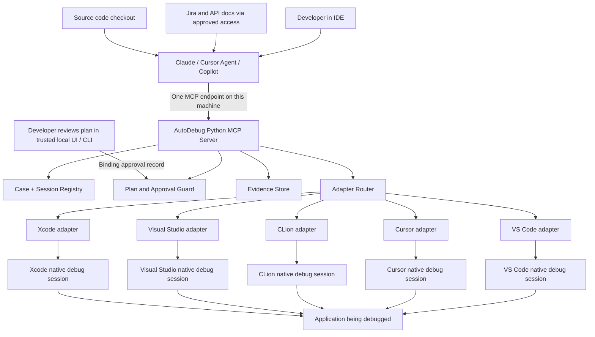
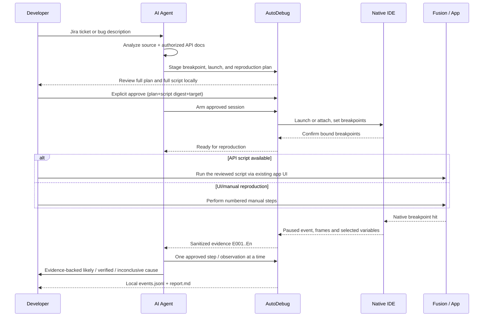

# AutoDebug — Architecture explained by ownership

**Status: fake-only MCP stdio operational; native deployment blocked.** A bounded
Python facade, standalone synthetic backend and five mock-validated adapters
exist; no real native-debugger integration is certified. The architecture separates **agent
reasoning**, **AutoDebug execution controls**, and **the existing native IDE
debugger**. AutoDebug itself does not contain an LLM.

## One picture



The five bottom IDEs are **alternatives**, not five debuggers connected to the same application simultaneously. A AutoDebug process on each computer connects to its locally running IDEs. Remote cross-computer debugging is **not in v1**.

## Which process does what?

| Process | It owns | It must NOT do |
|---|---|---|
| Claude / Copilot / Cursor agent | Read issue/source/docs, propose breakpoints/script, decide next observation, synthesize root cause | Claim human approval or directly alter an unapproved live process |
| AutoDebug Python MCP process | Tool exposure, plan validation, policy, routing, session identity, bounded inspection, evidence serialization | Invent a bug explanation, run its own LLM, bypass native debugger safety |
| IDE-specific adapter | Translate stable AutoDebug operations to documented backend interfaces | Fake unsupported debugger functionality |
| Native IDE + debugger | Attach/launch (where available), manage execution, breakpoints, stack, locals and stepping | Trust an AI-generated session ID without checking target process |
| Application | Runs actual app code and optionally its **existing** scripting mechanism | Automatically accept undisclosed injected code |
| Developer | Approves reviewed plan/script, chooses target, runs native Fusion script/UI steps | Be replaced by an agent's assertion of approval |

## Recommended repo modules (to create as coding tasks)

```text
src/autodebug/
  server.py              # Publish one local MCP interface
  models.py              # Versioned typed data contracts
  sessions.py            # Discover and pin IDE + debugger + PID identities
  router.py              # Session-specific adapter selection
  plans.py               # Immutable reviewed plan and script digest
  approvals.py           # Trusted local approval verification
  workflow.py            # Enforce state transitions and action limits
  evidence.py            # Sanitized JSONL observations; Markdown reports
  adapters/
    base.py              # Adapter Protocol + capability definition
    vscode.py
    cursor.py
    clion.py
    visual_studio.py
    xcode.py
  policy.py              # Security defaults, quotas, cancellation

tests/
  unit/
  contracts/
  integration/
  fixtures/
```

**Historical technology proposal:** Python 3.11+, an approved/pinned MCP SDK,
`pytest` and `ruff`. The current source-tree tests instead use standard-library
`unittest`, with Python 3.11/3.12 configured in CI; no MCP SDK, `pytest`, or `ruff`
is required or installed by the documented setup. Enterprise toolchain/package
acceptance and real deployment support remain unverified. See `README.md`.

## Adapter protocol — original interface

Every adapter should implement the **same core operations** with typed results:

1. `probe()` — installed? reachable? IDE/debugger version? exact supported capabilities?
2. `list_sessions()` — enumerate **actual** debugger sessions, not guess from process names.
3. `launch_or_attach(target, reviewed_configuration)` — only when approved and supported.
4. `set_breakpoints(session, resolved_locations)` — return individual **verified/bound** status.
5. `wait_for_stop(session, timeout)` — event or bounded polling; no endless busy loop.
6. `get_stack(session, frame_limit)` and `get_variables(session, frame_id, selected_names)` — minimum necessary capture.
7. `step(session, kind)` and `continue_execution(session)` — require an allowed, active approval scope.
8. `disconnect(session)` — do not kill the user's application unless explicitly requested and authorized.

Adapters may return `UNSUPPORTED`. A generic tool that succeeds in CLion but does not exist in Xcode must **not** claim Xcode support.

## Session IDs and routing

Example **illustrative** identity: `host-mac1/clion-7/session-3/pid-4182/generation-2`. Never key only on `Fusion360` or `active IDE`. Re-check PID, executable path, debugger session nonce, IDE instance and generation immediately before **each mutating command**. A stale or changed session fails closed.

## Launch/attach limitations (see `GW-06`)

Attaching to an already-running application can miss any breakpoint in code paths that executed before attach — there is no way to retroactively observe startup logic once it has run. Launching fresh only guarantees early breakpoints when the backend supports stop-at-entry or genuinely pending breakpoints set before process start; otherwise race conditions with application initialization are possible (see risk `R9`). A breakpoint that AutoDebug has **requested** is not a breakpoint that is **bound** — `RP-06` and `GW-06` both require an explicit bound/verified confirmation from the adapter before the developer is told to reproduce.

## What happens in a debugging investigation?



A script does not run just because it exists on disk. With the no-helper constraint, **Fusion's Scripts and Add-Ins UI is the execution trigger** unless a separately verified, approved existing mechanism is available.

## Worked example

Bug: "Opening a specific sketch sometimes enters an invalid geometry state." The agent verifies the relevant Fusion API methods against official documentation and actual source before generating a script. If adequate APIs exist, it creates an isolated, **non-destructive** reproduction using a disposable design, and the developer reviews the exact script and runs it through Fusion's own Scripts and Add-Ins UI. If the issue depends on a UI interaction the API can't reproduce faithfully, the agent issues numbered manual steps instead. No new Fusion add-in, embedded HTTP server, or undocumented script injection is in scope (see `RP-03`, `RP-07`).

## Report format

`report.md` (see `DE-05`, `DE-06`) follows this shape:

```text
Case / issue / source revision / OS / IDE and debugger version
Reproduction result: YES / NO / PARTIAL
Symptoms and exact steps (API or manual)
Observed call path and relevant variable values (redacted)
Root-cause statement: CONFIRMED / LIKELY / INCONCLUSIVE
Evidence IDs that support the statement
Uncertainties, alternative explanations, recommended verification test
Next action for the developer
```

**Never claim a cause is confirmed solely because a suspicious variable was observed.** Confirmation needs a verified causal path or a distinguishing regression/controlled test — see the `DE-06` bar in the debugging-and-evidence spec.

## Design review gates

Before implementation: validate active-native-session access in each IDE version, approved software dependencies, acceptance criteria, and trusted user approval mechanism. Before real debugger control: pass tests against fakes and make a user approve the precise selected target. Before shipping: complete the 11-case compatibility report with `PASS / PARTIAL / UNSUPPORTED / NOT_TESTED`, never blanket checkmarks.
