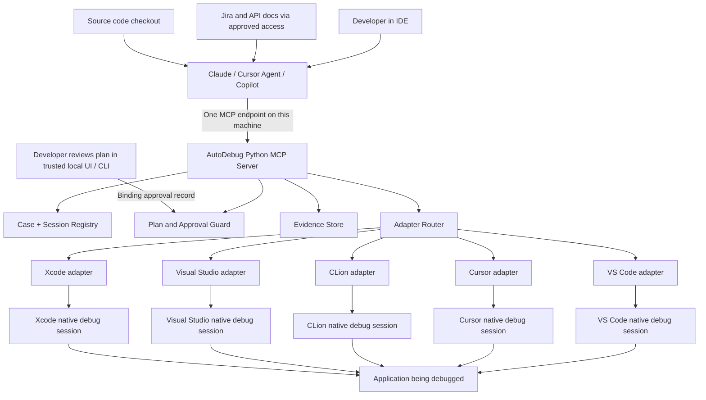
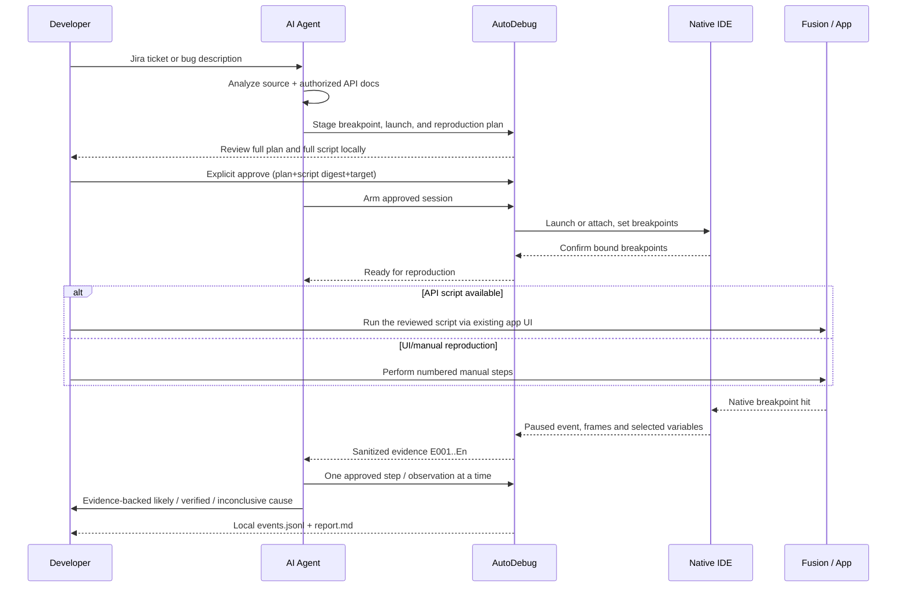

# Architecture

AutoDebug separates **agent reasoning** (the AI client), **execution controls**
(AutoDebug) and **the existing native IDE debugger**. AutoDebug contains no
LLM. Today only the synthetic backend is operational; the five IDE adapters
are mock-tested and no native integration is certified.

## One picture



The five bottom IDEs are **alternatives**, not five debuggers connected to the same application simultaneously. An AutoDebug process on each computer connects to its locally running IDEs. Remote cross-computer debugging is **not in v1**.

## Which process does what?

| Process | It owns | It must NOT do |
|---|---|---|
| Claude / Copilot / Cursor agent | Read issue/source/docs, propose breakpoints/script, decide next observation, synthesize root cause | Claim human approval or directly alter an unapproved live process |
| AutoDebug Python MCP process | Tool exposure, plan validation, policy, routing, session identity, bounded inspection, evidence serialization | Invent a bug explanation, run its own LLM, bypass native debugger safety |
| IDE-specific adapter | Translate stable AutoDebug operations to documented backend interfaces | Fake unsupported debugger functionality |
| Native IDE + debugger | Attach/launch (where available), manage execution, breakpoints, stack, locals and stepping | Trust an AI-generated session ID without checking target process |
| Application | Runs actual app code and optionally its **existing** scripting mechanism | Automatically accept undisclosed injected code |
| Developer | Approves reviewed plan/script, chooses target, runs native Fusion script/UI steps | Be replaced by an agent's assertion of approval |

## Source layout

```text
src/autodebug/
  cli.py           `autodebug serve | doctor | config` command line
  server.py        MCP stdio transport and tool schemas
  facade.py        The 15 autodebug_* tools; all re-checks and error envelopes
  workflow.py      Case state machine and legal transitions
  plans.py         Plan validation and canonical SHA-256 digest
  approvals.py     Approval broker prototype and authorize_and_arm
  router.py        Reuse / attach / launch / decline decision (GW-06)
  sessions.py      Session identity, ownership, leases, quarantine
  operations.py    Bounded backend calls with cancellation and late cleanup
  evidence.py      Redaction, bounded output, private evidence store, report
  models.py        Typed, versioned data contracts
  errors.py        Stable error codes
  synthetic.py     Isolated in-memory debugger for the --demo
  adapters/
    base.py        BaseAdapter, capability probing, ClientBackedAdapter
    vscode.py  cursor.py  clion.py  visual_studio.py  xcode.py
build_backend.py   Stdlib-only PEP 517 builder
tests/             unittest suites; fixtures/ holds fake adapters and clients
```

Python 3.11+, standard library only, tests with `unittest`.

## Adapter protocol — original interface

Every adapter should implement the **same core operations** with typed results:

1. `probe_capabilities()` — installed? reachable? IDE/debugger version? exact supported capabilities?
2. `list_sessions()` — enumerate **actual** debugger sessions, not guess from process names.
3. `launch_or_attach(target, reviewed_configuration)` — only when approved and supported.
4. `set_breakpoints(session, resolved_locations)` — return individual **verified/bound** status.
5. `wait_for_stop(session, timeout)` — event or bounded polling; no endless busy loop.
6. `get_stack(session, frame_limit)` and `get_variables(session, frame_id, selected_names)` — minimum necessary capture.
7. `step(session, kind)` and `continue_execution(session)` — require an allowed, active approval scope.
8. `disconnect(session)` — do not kill the user's application unless explicitly requested and authorized.

Adapters may return `UNSUPPORTED`. A generic tool that succeeds in CLion but does not exist in Xcode must **not** claim Xcode support.

## Session IDs and routing

Example **illustrative** identity: `host-mac1/clion-7/session-3/pid-4182/generation-2`. Never key only on `Fusion360` or `active IDE`. Re-check PID, executable path, debugger session nonce, IDE instance and generation immediately before **each mutating command**. A stale or changed session fails closed.

## Launch/attach limitations (see `GW-06`)

Attaching to an already-running application can miss any breakpoint in code paths that executed before attach — there is no way to retroactively observe startup logic once it has run. Launching fresh only guarantees early breakpoints when the backend supports stop-at-entry or genuinely pending breakpoints set before process start; otherwise race conditions with application initialization are possible (see risk `R9`). A breakpoint that AutoDebug has **requested** is not a breakpoint that is **bound** — `RP-06` and `GW-06` both require an explicit bound/verified confirmation from the adapter before the developer is told to reproduce.

## What happens in a debugging investigation?



A script does not run just because it exists on disk. With the no-helper constraint, **Fusion's Scripts and Add-Ins UI is the execution trigger** unless a separately verified, approved existing mechanism is available.

## Worked example

Bug: "Opening a specific sketch sometimes enters an invalid geometry state." The agent verifies the relevant Fusion API methods against official documentation and actual source before generating a script. If adequate APIs exist, it creates an isolated, **non-destructive** reproduction using a disposable design, and the developer reviews the exact script and runs it through Fusion's own Scripts and Add-Ins UI. If the issue depends on a UI interaction the API can't reproduce faithfully, the agent issues numbered manual steps instead. No new Fusion add-in, embedded HTTP server, or undocumented script injection is in scope (see `RP-03`, `RP-07`).

## Report format

`report.md` (see `DE-05`, `DE-06`) follows this shape:

```text
Case / issue / source revision / OS / IDE and debugger version
Reproduction result: YES / NO / PARTIAL
Symptoms and exact steps (API or manual)
Observed call path and relevant variable values (redacted)
Root-cause statement: CONFIRMED / LIKELY / INCONCLUSIVE
Evidence IDs that support the statement
Uncertainties, alternative explanations, recommended verification test
Next action for the developer
```

**Never claim a cause is confirmed solely because a suspicious variable was observed.** Confirmation needs a verified causal path or a distinguishing regression/controlled test — see the `DE-06` bar in the debugging-and-evidence spec.

## Gates before real use

Before real debugger control: a trusted user-approval mechanism, approved
dependencies and verified native-session access per IDE version. Before
shipping: the 11-cell compatibility ledger filled with real results, never
blanket checkmarks.
