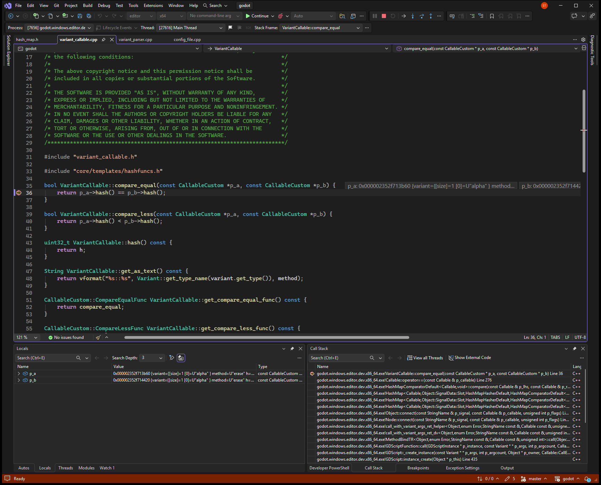
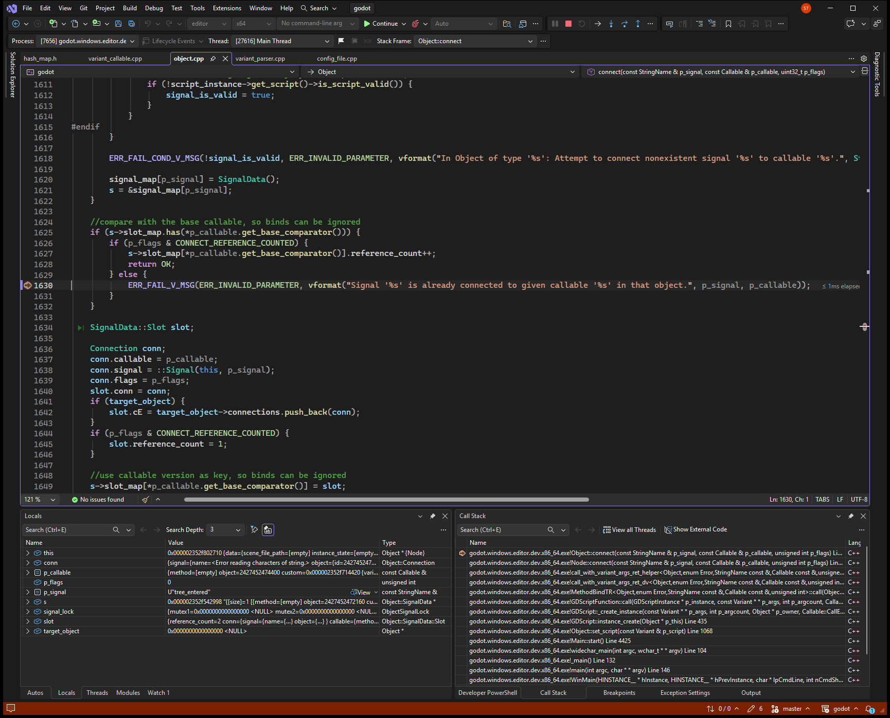

# Signal connect treats different arrays as the same callable

**Ticket:** [https://github.com/godotengine/godot/issues/116141](https://github.com/godotengine/godot/issues/116141)

## Problem

Connecting a signal to the same method on two different arrays that hold the same values fails. Godot prints: Signal 'tree_entered' is already connected to given callable 'Array::erase' in that object. The second array is not connected.

## Steps to reproduce

Reproducible: yes.

1. Run bin\godot.windows.editor.dev.x86_64.exe --headless --path repro\issue_116141 --script repro\issue_116141\repro.gd --quit.
2. The script connects ready to erase on two arrays with different values, then tree_entered to erase on two different arrays that both contain alpha.
3. The second tree_entered connect prints that the signal is already connected to Array::erase, and the script exits with an error.

## Debug sessions

Debugged in Visual Studio with `godot (editor|x64)`, editor x64 build.

Stopped in VariantCallable::compare_equal with two VariantCallable objects, both method erase and hash 3565074365, arrays at 0x000002352f62a010 and 0x000002352f62a070. Stepping the return showed compare_equal will return true. The caller was Callable::operator== from HashMap::_lookup_idx_unchecked, where p_hash was 3565074365 and the map already held the first callable on tree_entered. Continuing reached Object::connect line 1630 with p_signal tree_entered, p_flags 0, and slot_map size 1.

### Stop 1: compare_equal treats two different Array::erase callables as equal because both hashes are 3565074365, while the arrays are different objects at 0x2352f62a010 and 0x2352f62a070.

### Stop 2: Object::connect is about to reject tree_entered for the second Array::erase because the slot map already holds the other array's callable and compare_equal returned true.

## Root cause

### What went wrong

Object::connect looked up the new callable in the tree_entered slot map. The map already held one Array::erase callable (VariantCallable 0x000002352f713b60, ArrayPrivate 0x000002352f62a010, contents alpha). The new callable was a different VariantCallable (0x000002352f714420, ArrayPrivate 0x000002352f62a070, also alpha). Both hashes were 3565074365. VariantCallable::hash returned 3565074365 and VariantCallable::compare_equal returned true. HashMap::has therefore reported the key as present. p_flags was 0, so Object::connect took the error return for signal tree_entered.

### Why

VariantCallable::compare_equal returns only p_a->hash() == p_b->hash(). That hash comes from the variant value and the method, so two different arrays with the same contents and the same method share it. The slot map uses that result as key equality and never checks the array identity.

Confidence: Confirmed. A headless run printed the already-connected error. The debugger then showed compare_equal returning true for the two different arrays, and Object::connect stopped on the error line for tree_entered.

## Solution

In VariantCallable::compare_equal, cast both pointers to VariantCallable and return a->method == b->method && a->variant.identity_compare(b->variant). A hash mismatch can return false first. identity_compare uses Array::id(), the ArrayPrivate pointer, so these two arrays compare unequal. The same array connected twice still compares equal. Value types such as Vector2 stay equal when their values are equal, because identity_compare uses value comparison for them.

Follows the existing pattern: CallableCustomMethodPointerBase::compare_equal casts the two CallableCustom pointers and compares the stored identity, not the hash. Callable::operator== for an object callable compares the object id and the method. Variant::identity_compare already separates two arrays by Array::id().

Checked: The fix was not applied. The failure was reproduced and the comparison was read in the debugger. (reported by the AI agent)

## AI usage

- Model: Grok 4.7 (as the agent reported it)
- Tokens: not reported by the agent. Your AI app's usage page shows the exact count.
- AutoDebug: 12 tool calls, about 8,510 tokens of tool input and output (estimated at 4 characters per token; part of the total above).
