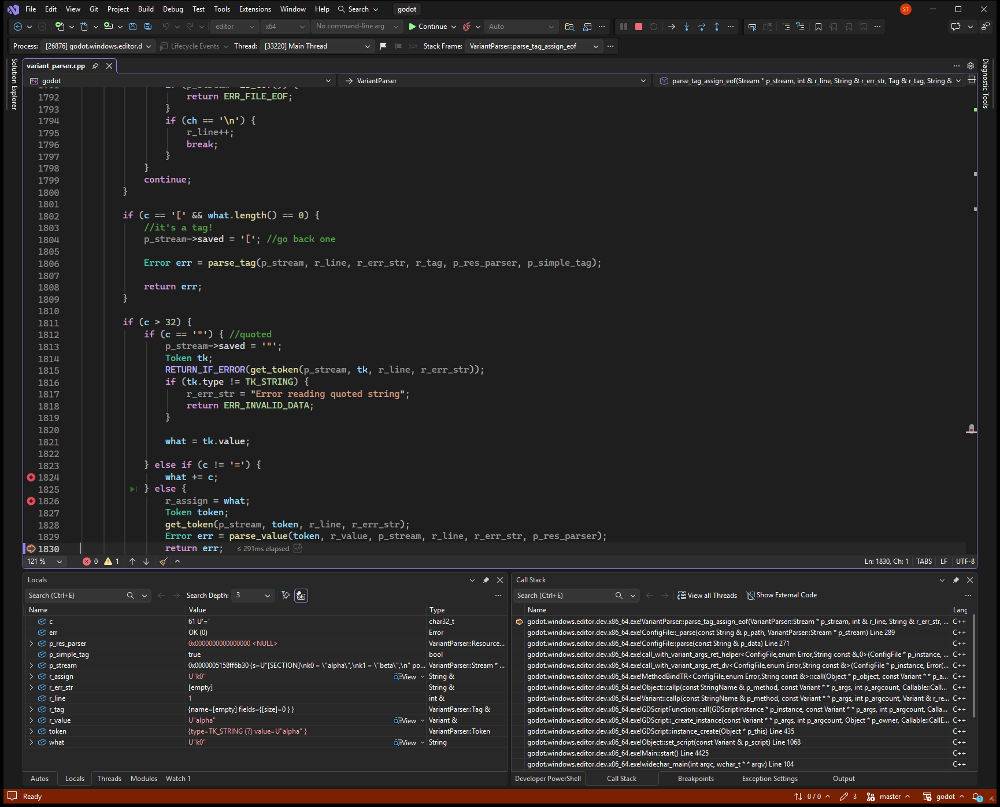
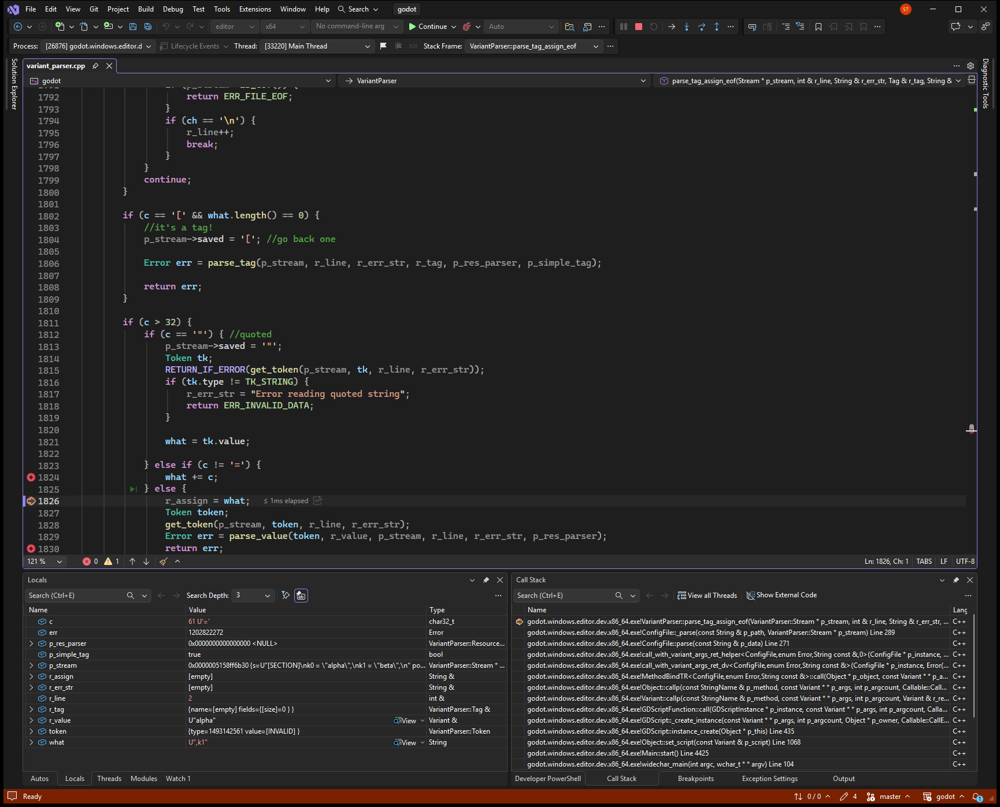

# Trailing text after a ConfigFile value is merged into the next key

**Ticket:** [https://github.com/godotengine/godot/issues/119459](https://github.com/godotengine/godot/issues/119459)

## Problem

ConfigFile.parse reports success when extra characters follow a value. Those characters are glued onto the next key, so a lookup for the real key does not find it.

## Steps to reproduce

Reproducible: yes.

1. Run bin/godot.windows.editor.dev.x86_64.exe --headless --script repro/issue119459/repro.gd
2. The script parses a config string with a trailing comma after each quoted value
3. It prints PARSE_ERR=0, KEY=,k1, and BUG, then exits 1

## Debug sessions

Debugged in Visual Studio with `godot (editor|x64)`, editor x64 build.

The first stop was the return after k0. err was OK, r_assign was k0, r_value was alpha, saved was 0, and readahead_buffer[22] was the comma. Stepping what += c changed what from empty to a single comma. The next stop was the equals sign, where what was ",k1" and r_line was 2. ConfigFile::_parse then had err OK, error_text empty, section SECTION, assign ",k1", and value beta, with k0 already stored as alpha.

### Stop 1: parse_tag_assign_eof is about to return OK for key k0 and value alpha while the next unread character is still the trailing comma.

### Stop 2: The leftover comma was appended to the next key, so what is ",k1" when the equals sign is reached.

## Root cause

### What went wrong

VariantParser::parse_tag_assign_eof parsed key k0 and value alpha, left err as OK, and returned at variant_parser.cpp:1830. The next unread character, readahead_buffer[22], was still ','. The following call appended that comma, so what went from empty to ",". At the equals sign, what was ",k1". ConfigFile::_parse received err OK and was about to store section SECTION, key ",k1", value beta.

### Why

parse_tag_assign_eof returns as soon as parse_value succeeds. It never checks the rest of the line. The next call starts a key with the leftover characters. ConfigFile::_parse stores whatever key that call returns when err is OK.

Confidence: Confirmed. Visual Studio showed the OK return while the unread character was the comma, then what equal to ",k1", then ConfigFile::_parse about to store that key. The same program printed KEY=,k1 and exited 1.

## Solution

After parse_value returns OK, finish the line before returning. Read p_stream->saved first, then the stream, because a number leaves the next character in saved. Skip characters at or below 32. On ';', skip to the newline the same way the top of parse_tag_assign_eof already skips a comment. A newline or end of file ends the assignment. Any other character, including the comma, sets r_err_str and returns ERR_PARSE_ERROR. ConfigFile::_parse already prints that error and returns it, so set_value is not called for the damaged key.

Follows the existing pattern: The ';' comment skip at the top of VariantParser::parse_tag_assign_eof, and the existing non-OK return in ConfigFile::_parse.

## AI usage

- Model: Grok 4.7 (as the agent reported it)
- Tokens: not reported by the agent. Your AI app's usage page shows the exact count.
- AutoDebug: 16 tool calls, about 7,118 tokens of tool input and output (estimated at 4 characters per token; part of the total above).
