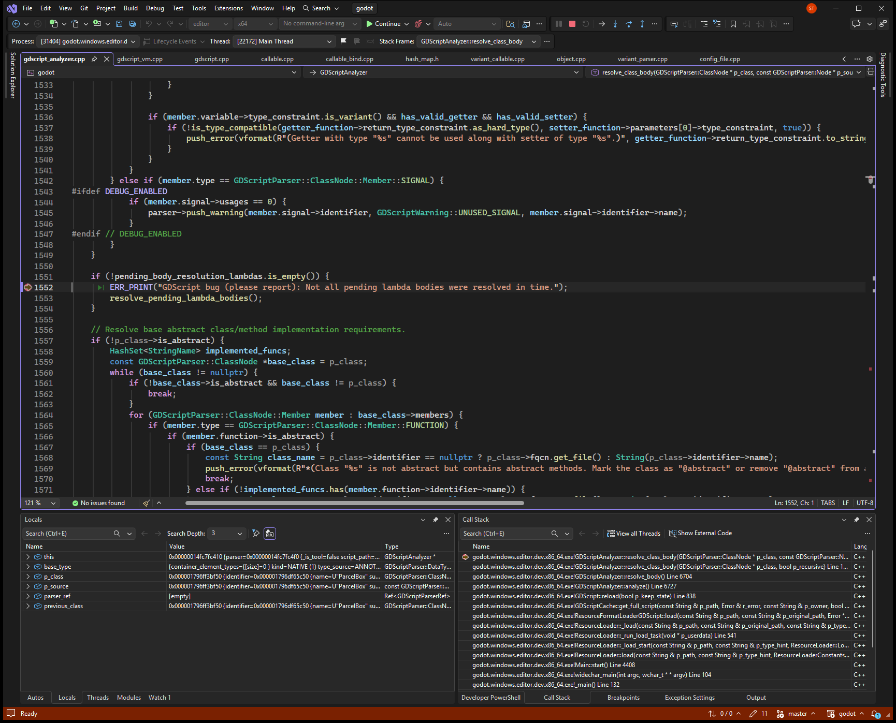
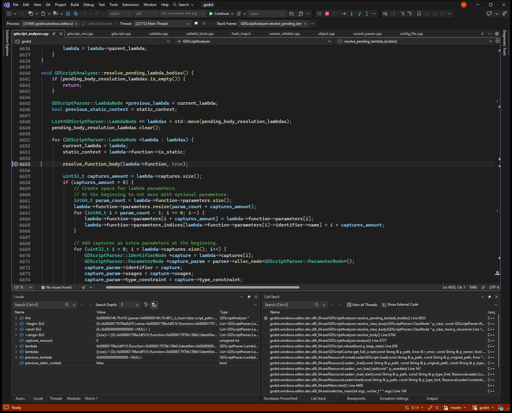

# Inner-class lambda default is resolved from the outer class

**Ticket:** [https://github.com/godotengine/godot/issues/123766](https://github.com/godotengine/godot/issues/123766)

## Problem

Loading a script prints "GDScript bug (please report): Not all pending lambda bodies were resolved in time." The script is an outer class with an inner class whose function default argument is a lambda. The script still loads. One load prints the error twice.

## Steps to reproduce

Reproducible: yes.

1. Add a script whose outer class contains an inner class, and give that inner class a function whose default argument is a lambda.
2. Run the editor binary headless with --check-only --script on that script.
3. The output prints that not all pending lambda bodies were resolved in time.

## Debug sessions

Debugged in Visual Studio with `godot (editor|x64)`, editor x64 build.

The first stop in reduce_lambda was during resolve_interface of ParcelBox::Parcel, member index 2, function _init. The lambda at line 7 was pushed with resolved_body false, and the pending list size became 1. The next stop was resolve_class_body of ParcelBox at the error line. The pending list was still that one lambda, Parcel.resolved_body was false, and the caller was the non-recursive call at line 1598, which returns before inner classes are visited. Stepping into the fallback showed resolve_pending_lambda_bodies called from line 1553 with current_class still ParcelBox. The same error line was hit again on a second analyzer of res://repro.gd, from GDScript::_update_exports in the same load.

### Stop 1: ParcelBox is about to report pending lambdas, but the only pending lambda belongs to inner class Parcel, whose body is still unresolved.

### Stop 2: The fallback resolves Parcel._init's lambda while current_class is still ParcelBox and Parcel's body has not started.

## Root cause

### What went wrong

Loading res://repro.gd queues the lambda that is the default argument of Parcel._init. At that stop, parser->current_class->fqcn was "ParcelBox::Parcel", the lambda function's resolved_body was false, and Parcel.resolved_body was false. The pending list size became 1. resolve_class_body for "ParcelBox" then hit the error with that same lambda still pending. ParcelBox.members[0] is the class "ParcelBox::Parcel", and its resolved_body was still false. The stack was the error line called from line 1598, which returns before the inner-class loop. The fallback resolve_pending_lambda_bodies, called from line 1553, ran with parser->current_class->fqcn still "ParcelBox" and Parcel.resolved_body still false. The lambda's parent function was "_init".

### Why

pending_body_resolution_lambdas is one list for the whole analyzer. A lambda in a default argument is queued during interface resolution, and its body is supposed to wait until the owning class body runs. Inner classes are interface-resolved before any body runs, so Parcel's lambda is already on the list when ParcelBox finishes its body. ParcelBox has no function suite to flush the list, and the overdue check runs before inner class bodies. The check prints the error and resolves the lambda while the current class is still the outer class.

Confidence: Confirmed. Visual Studio debugger on the editor x64 dev build. The check run printed the error, and the two captured stops show the pending lambda, the class names, and resolved_body.

## Solution

In GDScriptAnalyzer::resolve_class_body(ClassNode *p_class), just before the pending-lambda check and before parser->current_class is restored, resolve inner classes with the existing recursive helper:

for (const GDScriptParser::ClassNode::Member &member : p_class->members) {
    if (member.type == GDScriptParser::ClassNode::Member::CLASS) {
        resolve_class_body(member.m_class, true);
    }
}

The inner class then flushes its own lambda from resolve_suite while current_class is that inner class. Leave the check in place. Deleting only the ERR_PRINT still resolves the lambda from the outer class on the next line.

Follows the existing pattern: GDScriptAnalyzer::resolve_suite already calls resolve_pending_lambda_bodies after each statement while resolve_class_body has parser->current_class set to the class whose body is running.

Checked: The bug was reproduced with --check-only on repro/issue_123766/repro.gd. The fix was not applied. (reported by the AI agent)

## AI usage

- Model: Grok 4.7 (as the agent reported it)
- Tokens: not reported by the agent. Your AI app's usage page shows the exact count.
- AutoDebug: 22 tool calls, about 13,663 tokens of tool input and output (estimated at 4 characters per token; part of the total above).
