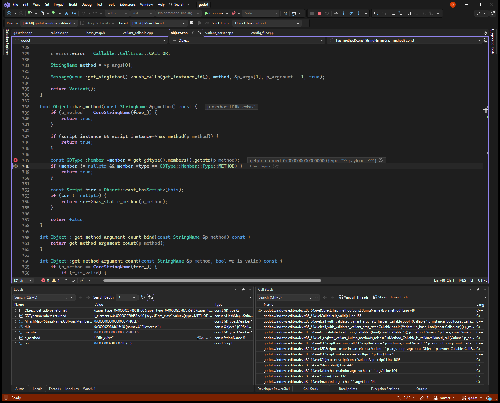
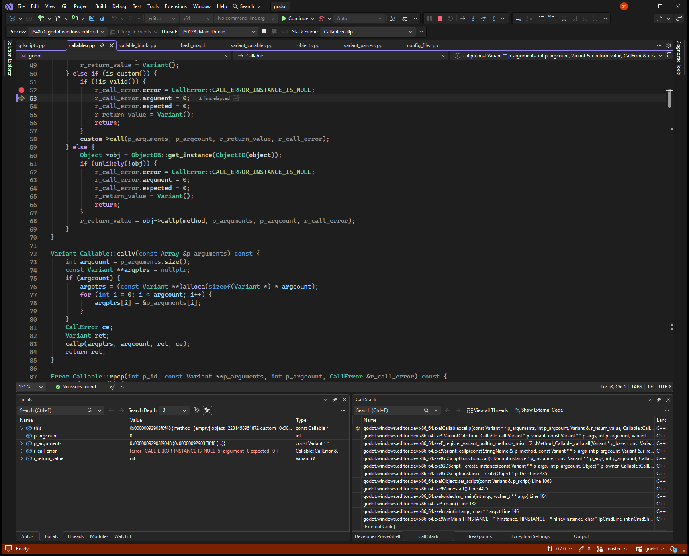

# Callable.is_valid is false for native static methods

**Ticket:** [https://github.com/godotengine/godot/issues/123848](https://github.com/godotengine/godot/issues/123848)

## Problem

A Callable taken from a native static method, such as FileAccess.file_exists, can be called, but Callable.is_valid() is false. After bind(), call() fails with: Attempt to call function 'GDScriptNativeClass::file_exists (Callable)' on a null instance.

## Steps to reproduce

Reproducible: yes.

1. Run bin/godot.windows.editor.dev.x86_64.exe --headless --path repro/issue_123848 -s res://repro.gd
2. The script assigns FileAccess.file_exists to a Callable and reads is_valid.
3. It calls that callable with user://probe_missing.txt.
4. It binds that path and calls the bound callable.

## Debug sessions

Debugged in Visual Studio with `godot (editor|x64)`, editor x64 build.

At GDScriptNativeClass::_get the wrapper name was FileAccess, p_name was file_exists, and the MethodBind _static flag was true with function FileAccess::exists. Object::has_method then searched GDType GDScriptNativeClass. Its only own method is new, and getptr(file_exists) returned null. The unbound Callable::callp still reached GDScriptNativeClass::callp, which called that MethodBind and got false with CALL_OK. CallableCustomBind::is_valid returned false. Callable::callp then stored CALL_ERROR_INSTANCE_IS_NULL and left the return value nil.

### Stop 1: has_method looks up file_exists on GDType GDScriptNativeClass and member is null, while the object wraps FileAccess.

### Stop 2: callp sets CALL_ERROR_INSTANCE_IS_NULL on the bound file_exists callable, whose wrapped object is still the live FileAccess class.

## Root cause

### What went wrong

FileAccess.file_exists is stored as a normal Callable on a GDScriptNativeClass whose name is FileAccess. Callable::is_valid asks that object for has_method(file_exists). The lookup uses GDType GDScriptNativeClass, whose only own method is new, so the member pointer is null and is_valid is false. The unbound call skips is_valid. GDScriptNativeClass::callp finds FileAccess::exists through ClassDB, and that call returns false with CALL_OK. bind() wraps the same callable in CallableCustomBind. Its is_valid returns false because the inner is_valid is false. Callable::callp then sets CALL_ERROR_INSTANCE_IS_NULL and returns nil without calling the method.

### Why

has_method is not virtual, so it never sees the wrapped class. It only searches GDScriptNativeClass. The static method is registered on FileAccess. callp is virtual, and GDScriptNativeClass::callp does look up that static method. is_valid and callp therefore disagree. Callable::callp trusts is_valid for every custom callable, so bind() turns a working callable into a failed call.

Confidence: Confirmed. Visual Studio stopped in the repro script. has_method's member pointer was null, the direct static call returned false with CALL_OK, and the bound call's r_call_error changed from CALL_OK to CALL_ERROR_INSTANCE_IS_NULL.

## Solution

Make Object::has_method virtual, the same way Object::callp already is. Override it on GDScriptNativeClass. If Object::has_method(p_method) is true, return true. Otherwise return ClassDB::get_method(name, p_method) && method->is_static(), which is the test callp already uses. Callable::is_valid and CallableCustomBind::is_valid then return true, so Callable::callp no longer rejects the bound callable.

Follows the existing pattern: GDScriptNativeClass::callp in modules/gdscript/gdscript.cpp. It already loads ClassDB::get_method(name, p_method) and calls the method when method->is_static() is true.

Checked: The fix was not applied. The headless repro printed the null-instance error, and the debugger showed the false validity check and the rejected bound call. (reported by the AI agent)

## AI usage

- Model: Grok 4.7 (as the agent reported it)
- Tokens: not reported by the agent. Your AI app's usage page shows the exact count.
- AutoDebug: 26 tool calls, about 13,230 tokens of tool input and output (estimated at 4 characters per token; part of the total above).
