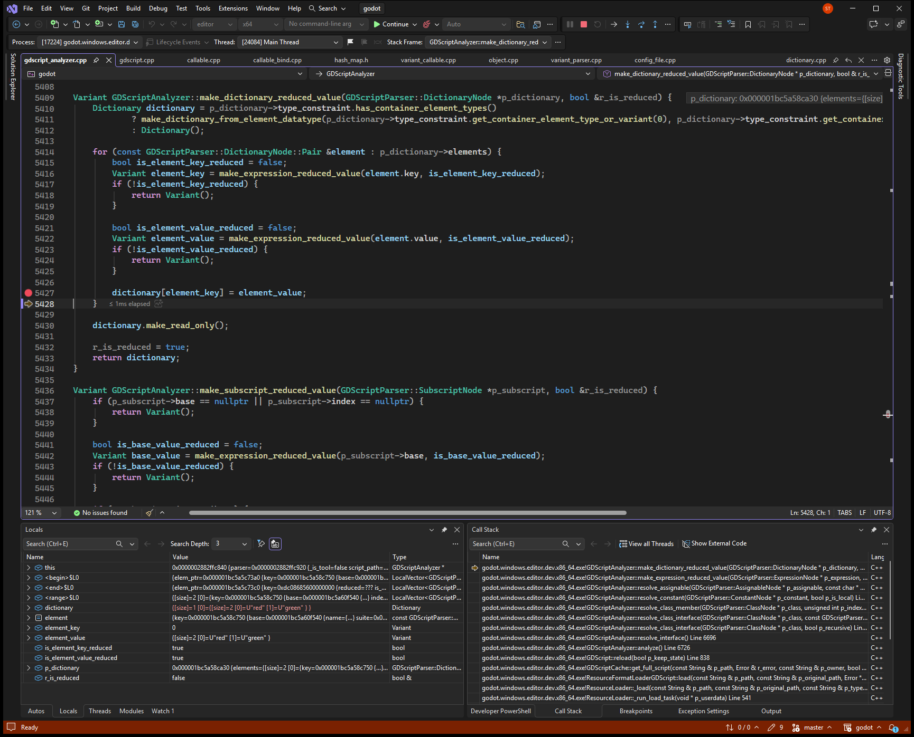
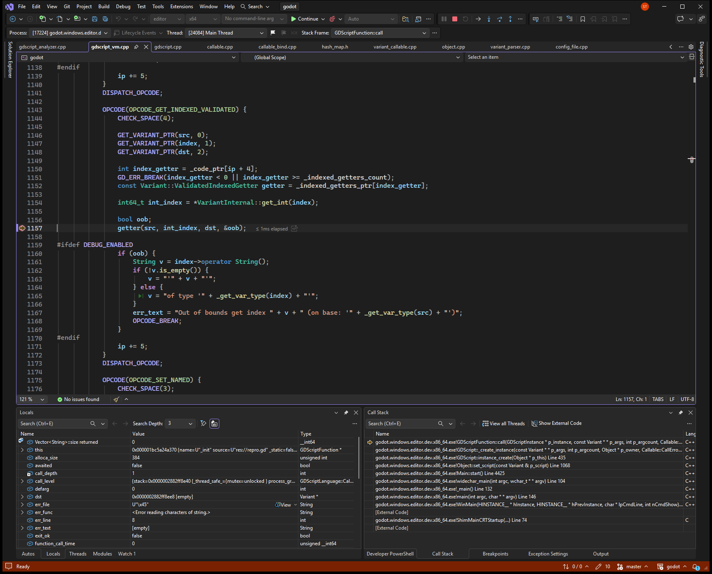

# Constant dictionary stores an Array and indexes it as a PackedStringArray

**Ticket:** [https://github.com/godotengine/godot/issues/124061](https://github.com/godotengine/godot/issues/124061)

## Problem

Indexing a PackedStringArray value from a constant typed Dictionary crashes. In this debug build the same access reports that index 0 is out of bounds on an Array, and the string is never returned.

## Steps to reproduce

Reproducible: yes.

1. Open the editor dev binary on repro/issue_124061.
2. Run it headless with --path repro/issue_124061 -s res://repro.gd --disable-crash-handler.
3. The script prints direct0=red and before_dict, then fails on WORDS[slot][0].

## Debug sessions

Debugged in Visual Studio with `godot (editor|x64)`, editor x64 build.

At gdscript_analyzer.cpp:5428 the constant dictionary slot for key 0 held type ARRAY (28), the array [red, green]. operator[] had initialized that slot as an empty PackedStringArray (type 34) and the assignment replaced it. At gdscript_vm.cpp:1157, _init line 16 called VariantIndexedSetGet_PackedStringArray::get on that same Array. Vector<String>::size() returned 0 and oob became true.

### Stop 1: Assigning the array [red, green] into the typed dictionary stored type ARRAY, not PackedStringArray.

### Stop 2: PackedStringArray::get indexed an Array holding red and green; size() returned 0, so index 0 was out of bounds.

## Root cause

### What went wrong

make_dictionary_reduced_value assigned the Array [red, green] (type ARRAY, 28) into a slot that operator[] had initialized as an empty PackedStringArray (type 34). After that assignment the stored value was still ARRAY. At runtime, _init line 16 called VariantIndexedSetGet_PackedStringArray::get on that Array with index 0. The getter read the Array memory as a PackedStringArray, Vector<String>::size() returned 0, and oob was set to true. The engine then reported: Out of bounds get index '0' (on base: 'Array').

### Why

Dictionary::operator[] does not convert a value to the dictionary value type. Variant assignment sees Array and PackedStringArray as different types, so it stores the Array and changes the variant type. The script type is still PackedStringArray, so the VM calls the packed-string getter. That getter does not check the variant type. In this build the misread size is 0, so the bounds check fails. The reported crash is this same getter at variant_setget.cpp:867: when the misread size is greater than the index, it copies a string and CowData<char32_t>::operator= loads a bad refcount.

Confidence: Confirmed. Visual Studio debugger on the unoptimized editor x64 dev build. The stored variant type, the getter function, and size() were read from Locals at the two captured stops.

## Solution

In GDScriptAnalyzer::make_dictionary_reduced_value, store each entry with dictionary.set(element_key, element_value) instead of dictionary[element_key] = element_value. If set returns false, do not treat the dictionary as a reduced constant.

Follows the existing pattern: Dictionary::set in core/variant/dictionary.cpp. It calls typed_value.validate, which converts an Array into a PackedStringArray. The comment on Dictionary::operator[] already says to use set() when the value may not match the typed dictionary.

Checked: The fix was not applied or run. (reported by the AI agent)

## AI usage

- Model: Grok 4.7 (as the agent reported it)
- Tokens: not reported by the agent. Your AI app's usage page shows the exact count.
- AutoDebug: 33 tool calls, about 10,964 tokens of tool input and output (estimated at 4 characters per token; part of the total above).
